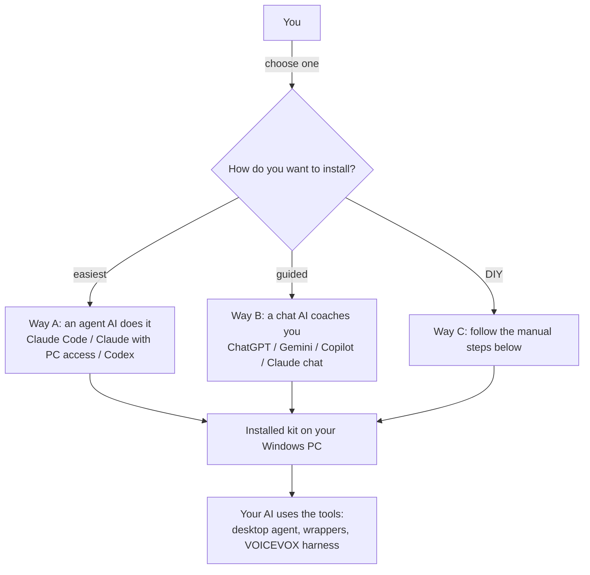

# Setup Guide — Agent Hands Kit

**A beginner-friendly, step-by-step guide to installing Agent Hands Kit on a Windows PC and handing it to your AI.**

> 日本語要約：導入方法は3つあります。①PCを操作できるAI（Claude等）にリンクを渡して「これを適用して」と頼む（いちばん簡単）。②チャットAI（ChatGPT / Gemini 等）に先生役を頼み、画面を見せながら一歩ずつ進める。③このガイドを読んで自分で入れる。どれでも行き着く先は同じです。

---

## What you are installing

Agent Hands Kit is a set of small tools that let an AI agent **see and operate a real Windows desktop** (screenshots, UI element snapshots, clicks, typing), **run creative apps headlessly** (Blender, Inkscape, GIMP, FreeCAD, KiCad, LTspice), and optionally **synthesize Japanese speech** through VOICEVOX without touching its GUI. Everything runs locally on your own PC; the desktop agent listens on `127.0.0.1` only, with token authentication.



## What you need

| Item | Notes |
|---|---|
| A Windows 10/11 PC | The kit is Windows-native. You should be logged in as an administrator for setup. |
| Internet access | To download the kit and the .NET SDK. |
| .NET 10 SDK | Only needed to build the Desktop Agent from source (Way C, or Way A where the AI builds it). Free from Microsoft. |
| PowerShell 5.1+ | Built into Windows. Nothing to install. |
| Optional: Blender / Inkscape / GIMP / FreeCAD / KiCad / LTspice | Only the ones you actually want the AI to run. Install them normally; the wrappers find them automatically. |
| Optional: VOICEVOX | Only for the speech harness. Install from the official VOICEVOX site. |
| Optional: Python 3 | Only for the VOICEVOX harness (with `numpy` and `soundfile`). |

> 日本語：必須は Windows PC とネット接続だけ。アプリ系（Blender等）と VOICEVOX は、使いたいものだけでOKです。

---

## Way A — Let an AI agent do it (easiest)

If you use an AI that can **run commands on your PC** — for example Claude Code, the Claude desktop app in a code/agent session, OpenAI Codex, or a local LLM with shell access — you do not need to touch a terminal yourself. Give the AI this repository and one instruction.

**Copy-paste prompt (English):**

```text
Read the setup guide at https://github.com/thanatos333/agent-hands-kit/blob/main/SETUP.md
and set up Agent Hands Kit on this Windows PC, following "Way C" in that guide.
Rules: work step by step; after each component, run its verification check and
show me the result line (success lines end with _OK). Do not skip the Desktop
Agent screenshot test. If a step fails, show me the error and your fix before
continuing. When everything is done, give me a short summary of what is
installed and where.
```

**そのまま使える日本語版：**

```text
https://github.com/thanatos333/agent-hands-kit/blob/main/SETUP.md の導入ガイドを読んで、
このWindows PCに Agent Hands Kit をセットアップしてください。手順はガイドの「Way C」に従うこと。
部品ごとに検証まで行い、結果行（成功は _OK で終わる行）を見せてください。
Desktop Agent のスクリーンショット確認は省略しないこと。
失敗したら、エラーと対処を見せてから続けてください。
最後に、何がどこに入ったか短くまとめてください。
```

What happens next: the AI clones the repository, builds the Desktop Agent, registers its startup task, copies the tools, and runs the checks. You only watch and answer questions if it asks. Expect it to take a few minutes, most of it the first .NET build.

> 日本語：PCを操作できるAIなら、リンクと上の文を貼るだけで導入が終わります。これが一番楽な方法です。

---

## Way B — A chat AI as your coach

Chat-only AIs (ChatGPT, Gemini, Copilot, Claude in a normal chat) **cannot touch your PC**. They can still make setup painless by coaching you one step at a time — you do the clicking, the AI reads your screenshots and tells you the next move.

1. Open your chat AI and paste this prompt:

```text
You are my setup coach. Read this guide:
https://github.com/thanatos333/agent-hands-kit/blob/main/SETUP.md
I will install Agent Hands Kit on my Windows PC following "Way C".
Guide me ONE step at a time: tell me exactly what to do, wait for me to
reply "done" or send a screenshot, then give me the next step.
If I paste an error message, explain in plain words what it means and
what to do. Do not dump the whole guide at once.
```

2. Follow its instructions. When something on your screen differs from what the AI expects, **send it a screenshot** — that is the fastest way to unstick any setup.
3. At each verification step, paste the AI the last line of the tool output. Success lines end with `_OK` (for example `VV_OK ...`); failure lines contain `_FAILED` plus a reason. The kit is designed so that this single line tells the truth.

> 日本語：チャットAIはPCを触れませんが、先生役にはなれます。詰まったらスクリーンショットを送るのが一番早いです。

---

## Way C — Manual setup

You only need the parts you will use. The Desktop Agent is the core; everything else is optional and independent.

### Step 0 — Get the files

- **With git:** `git clone https://github.com/thanatos333/agent-hands-kit.git`
- **Without git (beginner-friendly):** open the repository page, click **Code → Download ZIP**, and unzip it anywhere (for example `C:\agent-hands-kit`).

### Step 1 — Desktop Agent (the GUI hands)

This is a small C# program. You build it once; it then lives in `%USERPROFILE%\tools\desktop-agent\` and starts automatically at logon.

1. Install the **.NET 10 SDK** from Microsoft's site (free). Check it worked: open PowerShell and run `dotnet --version`.
2. Build and place the agent (run inside the unzipped/cloned folder):

```powershell
dotnet publish components\desktop-agent -c Release -o $env:USERPROFILE\tools\desktop-agent
```

3. Register the logon task. The task name matters — the client looks for exactly `AronaDesktopAgent`:

```powershell
$exe = "$env:USERPROFILE\tools\desktop-agent\desktop-agent.exe"
$action    = New-ScheduledTaskAction -Execute $exe -Argument "serve"
$trigger   = New-ScheduledTaskTrigger -AtLogOn
$principal = New-ScheduledTaskPrincipal -UserId $env:USERNAME -LogonType Interactive -RunLevel Highest
Register-ScheduledTask -TaskName "AronaDesktopAgent" -Action $action -Trigger $trigger -Principal $principal
Start-ScheduledTask -TaskName "AronaDesktopAgent"
```

The first time the server starts, it creates its own access token at `%USERPROFILE%\tools\desktop-agent\token.txt`. You never need to open that file; the client reads it for you. The agent also shows a tray icon while it runs.

4. **Verify** (this is the important part):

```powershell
& $env:USERPROFILE\tools\desktop-agent\desktop-agent.exe status
& $env:USERPROFILE\tools\desktop-agent\desktop-agent.exe screenshot --scale 0.5
```

The first command prints a JSON status. The second saves a screenshot of your desktop into `%USERPROFILE%\tools\desktop-agent\shots\` — open it and confirm it really shows your screen. From now on, any AI on this PC can drive the desktop through the thin client:

```powershell
powershell -ExecutionPolicy Bypass -File components\desktop-agent\desktop.ps1 status
```

Full command list and design notes: `components/desktop-agent/README.md`.

> 日本語：Desktop Agent は最初に1回ビルドするだけ。あとはログオン時に自動で常駐します。最後のスクリーンショット確認だけは省略しないでください（「本当に画面が見えているか」の証明になります）。

### Step 2 — PowerShell tools

A folder of single-purpose tools (background jobs, output capping, document text extraction, web reading, file search, delegation helpers). They expect one environment variable, `AGENT_HOME`, pointing at a home folder for the tools; some tools look for siblings under `$env:AGENT_HOME\tools\`.

1. Pick a home folder, for example `C:\agent-home`, and copy the contents of `components\powershell-tools\` and `components\app-wrappers\` into `C:\agent-home\tools\`.
2. Set the variable (once, for your user account):

```powershell
[Environment]::SetEnvironmentVariable('AGENT_HOME', 'C:\agent-home', 'User')
```

3. Open a **new** PowerShell window (so it picks up the variable) and try one:

```powershell
powershell -ExecutionPolicy Bypass -File C:\agent-home\tools\tool-help.ps1
```

Notes for beginners:

- If Windows refuses to run a script ("running scripts is disabled"), the `-ExecutionPolicy Bypass` in the examples handles it per-run. Alternatively, allow local scripts for your account once: `Set-ExecutionPolicy -Scope CurrentUser RemoteSigned`.
- A few tools (`delegate.ps1`, `run-scheduled.ps1`) are working examples from the author's own local-LLM setup. Treat them as templates to adapt, not turnkey features.
- Every tool prints its verdict on the **last line**: `*_OK` means success, `*_FAILED <reason>` means failure. See `components/powershell-tools/INDEX.md` for the list.

### Step 3 — App wrappers (Blender / Inkscape / GIMP / FreeCAD / KiCad / LTspice)

Nothing to configure: install the apps you use (normal Windows installers), and the wrappers locate them under Program Files, `%LOCALAPPDATA%\Programs`, or the PATH.

Quick test that needs no creative app — the image preview tool:

```powershell
powershell -ExecutionPolicy Bypass -File C:\agent-home\tools\img-peek.ps1 -Image C:\path\to\any.png
# last line: IMGPEEK_OK <preview path> size=... src=...
```

Then, for an app you installed, e.g. Blender with your own script:

```powershell
powershell -ExecutionPolicy Bypass -File C:\agent-home\tools\blender-run.ps1 -Script C:\path\to\your_script.py
```

Success is judged by the declared output files, not just the exit code. Details: `components/app-wrappers/INDEX.md`.

### Step 4 — VOICEVOX harness (optional, Japanese speech)

Lets an AI synthesize speech through the VOICEVOX engine API — no GUI clicking, with the accent/pitch plan printed and the output verified by measuring its pitch (F0) contour.

1. Install **VOICEVOX** from its official site (default install location is fine).
2. Install **Python 3**, then create a virtual environment next to the harness files and add the two libraries:

```powershell
copy components\voicevox-harness\vv_harness.py C:\agent-home\tools\
copy components\voicevox-harness\vv-say.ps1   C:\agent-home\tools\
cd C:\agent-home\tools
python -m venv .venv
.\.venv\Scripts\python.exe -m pip install numpy soundfile
```

(The wrapper finds `vv_harness.py` beside itself and the `.venv` Python automatically; or set `VV_HOME` / `VV_PYTHON` to point elsewhere.)

3. Synthesize a test line (speaker 10 = Amahare Hau, normal style):

```powershell
powershell -ExecutionPolicy Bypass -File C:\agent-home\tools\vv-say.ps1 -Text "はじめまして。私の声、聞こえてますか？" -Speaker 10
# last line: VV_OK <wav path>
```

The engine starts automatically if VOICEVOX is not running. Play the WAV to hear the result. Details: `components/voicevox-harness/README.md`.

### Step 5 — Notification watcher (optional)

A small helper that turns Windows notifications into an event source for agents. Source is in `components/notification-watcher/`; build and storage paths are environment-variable driven. Most users can skip this on day one.

---

## Connecting your AI to the kit

- **AI running on the same PC** (Claude Code, a local LLM, etc.): it just runs the commands above — `desktop.ps1` for the desktop, the wrappers for apps, `vv-say.ps1` for speech. Point it at the component READMEs and INDEX files; they are written to be read by AIs.
- **AI running elsewhere** (a cloud assistant): it needs a way to reach your PC. The author's setup uses SSH over a private network (Tailscale) for commands, plus a shared folder as a "file mailbox" for instructions and results — see `mailbox/` and `patterns/` in this repository. The desktop agent itself is never exposed to the network; the AI talks to the PC, and the PC talks to the agent on localhost.

## Final check — the two-minute drill

Whichever way you installed, finish with this end-to-end test. Ask your AI (or run it yourself):

1. Take a screenshot with the desktop agent and describe what is on screen.
2. Run `img-peek.ps1` on that screenshot and confirm the last line is `IMGPEEK_OK ...`.
3. If you installed the VOICEVOX harness, synthesize one line and confirm `VV_OK`.

If all three pass, your AI has eyes, hands, and a voice. 🎉

> 日本語：最後に「スクリーンショットを撮って説明して」のドリルを必ず。見える・触れる・（任意で）喋れる、が揃えば導入完了です。

## Troubleshooting

| Symptom | What it means / what to do |
|---|---|
| `dotnet` not recognized | The .NET SDK is not installed, or the PowerShell window predates the install. Install the SDK and open a new window. |
| "running scripts is disabled on this system" | Use `-ExecutionPolicy Bypass` per run (as in the examples), or `Set-ExecutionPolicy -Scope CurrentUser RemoteSigned` once. |
| Desktop agent client says "token file not found" or "cannot reach the server" | The resident server is not running. Start it with `Start-ScheduledTask -TaskName "AronaDesktopAgent"`, then retry. |
| Screenshot command refuses, mentioning a locked desktop | By design: the agent refuses to operate while the screen is locked or a UAC secure desktop is showing. Unlock the PC and retry. |
| A wrapper ends with `_FAILED` | Read the reason on that same line — it names the missing app, file, or output. Also confirm the app itself is installed. |
| `vv-say.ps1` ends with `VV_FAILED no python found` | Create the `.venv` next to `vv-say.ps1` (Step 4), or set `VV_PYTHON` to your Python. |
| `VV_FAILED` mentioning the engine | VOICEVOX is not installed, or its engine failed to start. Start VOICEVOX once by hand, then retry. |

## Safety, in one paragraph

The Desktop Agent only listens on `127.0.0.1` and requires a per-user token; it logs every action and can be stopped from its tray icon, with the `stop` command, or by placing a `STOP` file next to it. It is a tool for **your** PC and **your** AI — read `SECURITY.md` before use, and never expose the agent port to a network.
